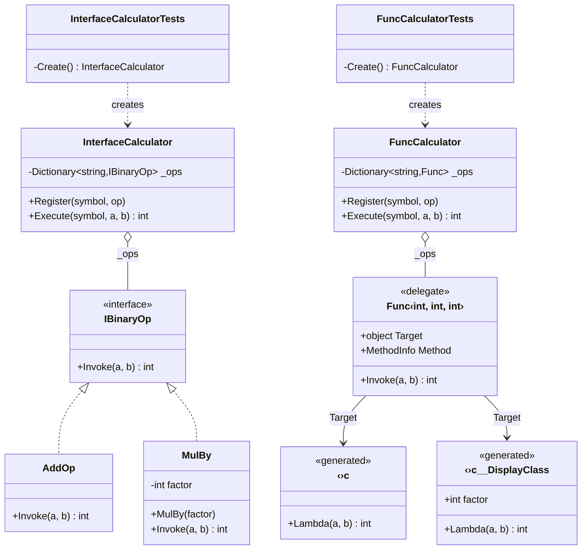
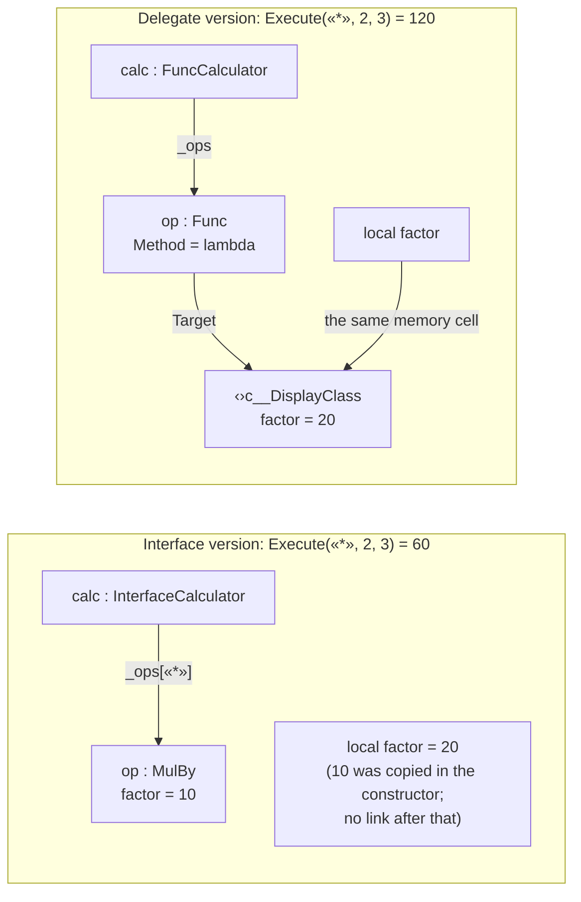

# Level 0. A delegate by hand, through an interface

**Status:** `AI-generated · Human-verified up to task C, test 3`

[← Part 1](README.md) · [Level 1 →](level-1.md)

A delegate is an object holding two things: a reference to an object (`Target`) and a reference to a method (`Method`), plus an `Invoke` method. In essence it is a single-method interface whose class the compiler writes for you. This level has no delegates at all: you write everything by hand with interfaces, then fold it into delegates and see that the behaviour has not changed.

Plan for two 50-minute blocks (realistically 3–4 blocks on the first pass):

| Block | What you do | Result |
| --- | --- | --- |
| 1 | Exercises A and B | Interface calculator and its `Func` copy, one test suite |
| 2 | Exercises C and D | Observer by hand and via `event`, tests on `Target` instead of the debugger |

Order inside each exercise: one test, red → minimal code → green → refactor. Write the next test only after green.

Understand:

- Which classes and fields will the compiler generate for `Func<int, int> f = x => x * factor;` if `factor` is a local variable?
- How is a subscriber list `List<IOrderListener>` different from a multicast delegate? What does the delegate do for you?
- Why do people say a capturing lambda “allocates”, but a static method does not?

## Exercise A: a calculator without delegates

```csharp
public interface IBinaryOp { int Invoke(int a, int b); }

public class AddOp : IBinaryOp
{
    public int Invoke(int a, int b) => a + b;
}

// “Capturing” a variable by hand: what a lambda captures becomes a field
public class MulBy(int factor) : IBinaryOp
{
    public int Invoke(int a, int b) => a * b * factor;
}

public class InterfaceCalculator
{
    public void Register(string symbol, IBinaryOp op) { }
    public int Execute(string symbol, int a, int b) => throw new NotImplementedException();
}
```

Test order for A. Each next test forces exactly one new thing into the code:

1. An unknown symbol throws `InvalidOperationException`. The stub throws `NotImplementedException`, so the test is red. Minimal code: `throw new InvalidOperationException(...)`.
2. `Register("+", new AddOp())`, then `Execute("+", 2, 3) == 5`. This is where `Dictionary<string, IBinaryOp>` and `TryGetValue` appear.
3. `MulBy(10)` under `"*"` gives 60. The calculator code doesn't change: you only write a new operation class. That is the whole point of the abstraction.
4. Registering the same symbol again replaces the operation (dictionary indexer, not `Add`).
5. `Register("+", null!)` throws `ArgumentNullException`.

To reuse the tests at level 1, create the calculator through one factory method and keep registration in one place:

```csharp
public class InterfaceCalculatorTests
{
    private static InterfaceCalculator Create()
    {
        var calc = new InterfaceCalculator();
        calc.Register("+", new AddOp());
        calc.Register("*", new MulBy(10));
        return calc;
    }

    [Fact]
    public void Execute_unknown_symbol_throws() =>
        Assert.Throws<InvalidOperationException>(() => Create().Execute("%", 2, 3));

    [Theory]
    [InlineData("+", 2, 3, 5)]
    [InlineData("*", 2, 3, 60)]
    public void Execute_registered_op(string symbol, int a, int b, int expected) =>
        Assert.Equal(expected, Create().Execute(symbol, a, b));
}
```

## Exercise B: fold it into delegates

1. Copy the calculator and replace `IBinaryOp` with `Func<int, int, int>`.
2. `AddOp` becomes `(a, b) => a + b`, and `MulBy(10)` becomes `(a, b) => a * b * factor` with a local `int factor = 10`.
3. The same tests must pass unchanged, except for the registration lines.
4. Write down in two columns what got shorter in the second version and what the compiler does for you.

Template for the two columns (fill it in yourself, then compare):

| Interface version | Delegate version |
| --- | --- |
| `interface IBinaryOp { int Invoke(int, int); }` | `Func<int, int, int>` (or your own `delegate int BinaryOp(int a, int b);`) |
| `class AddOp : IBinaryOp` | a non-capturing lambda or the method group `Add` |
| `class MulBy(int factor)`, field `factor` | a closure: the compiler creates a `<>c__DisplayClass` class with a `factor` field |
| `new MulBy(10)` | creating a closure object + a delegate object |
| `op.Invoke(a, b)` | `op(a, b)`, sugar for `op.Invoke(a, b)` |

One important difference worth checking with a test: `MulBy` copies the **value** of `factor` in its constructor, while the lambda captures the **variable**. If you write `factor = 20` after registration, `Execute("*", 2, 3)` returns 120 in the delegate version but stays 60 in the interface version. Write both tests and explain the difference out loud.

Declare `factor` as a local variable in the test itself, not inside `Create()`: otherwise there is nothing to change after registration.

Class diagram of tasks A and B:



The left half is what you write by hand in task A, the right half the same thing with delegates. `MulBy` and `‹›c__DisplayClass` play the same role: they hold `factor`, except the second class is generated by the compiler.

Memory after `factor = 20`:



In the interface version the link to the variable ends in the constructor; in the delegate version the variable and the delegate point to the same closure field. Hence 60 and 120.

## Exercise C: a hand-made Observer versus an event

- Interface `IOrderListener { void OnPaid(Order order); }` and a `ManualOrderPublisher` class with a listener list, `Subscribe`, `Unsubscribe` and `Pay()`, which walks the list.
- Tests: two listeners are called in subscription order; after `Unsubscribe` a listener is no longer called.
- Then the same via `event Action<Order>? Paid`. Compare: `+=` and `-=` replaced `Subscribe` and `Unsubscribe`, and the `List` was replaced by the invocation list inside the delegate.

Who is who in this task:

| Observer role | Manual version | Event version |
| --- | --- | --- |
| Publisher (who notifies) | `ManualOrderPublisher` | `EventOrderPublisher` |
| Subscriber (who listens) | an `IOrderListener` implementation, e.g. `RecordingListener` | any `void (Order)` method subscribed via `Paid +=` |
| Message (what is passed) | `Order` | `Order` |

`Order` is just data: an immutable `record` that knows nothing about subscribers or events.

You subscribe to the event with the listener's method: `publisher.Paid += a.OnPaid;` (a method group). The event doesn't need the `IOrderListener` interface; any method with a matching signature will do. Unsubscribing with `publisher.Paid -= a.OnPaid;` works even though `a.OnPaid` creates a new delegate each time: delegates are compared by `Target` and `Method`, not by reference.

Starter code for C:

```csharp
public record Order(int Id, decimal Total);

public interface IOrderListener { void OnPaid(Order order); }

public class ManualOrderPublisher(Order order)
{
    private readonly List<IOrderListener> _listeners = new();
    public void Subscribe(IOrderListener l) => throw new NotImplementedException();
    public void Unsubscribe(IOrderListener l) => throw new NotImplementedException();
    public void Pay() => throw new NotImplementedException();
}

public class EventOrderPublisher(Order order)
{
    public event Action<Order>? Paid;
    public void Pay() => throw new NotImplementedException();
}

// In tests: a listener that writes its name into a shared log
public class RecordingListener(string name, List<string> log) : IOrderListener
{
    public void OnPaid(Order order) => log.Add(name);
}
```

Test order (first for `ManualOrderPublisher`, then the same ones for `EventOrderPublisher`):

1. `Pay()` with no subscribers doesn't crash. In `EventOrderPublisher` this is where `Paid?.Invoke(order)` shows up: an empty event is `null`.
2. Two subscribers A and B; the log equals `["A", "B"]`.
3. After A unsubscribes, the log equals `["B"]`.
4. For `EventOrderPublisher`: unsubscribing with a **new** lambda with the same text doesn't work, but unsubscribing through a saved variable `Action<Order> h = ...; publisher.Paid += h; publisher.Paid -= h;` does. These are two demonstration tests: the publisher code doesn't change. Write down why (hint: delegate equality compares `Target` and `Method`).
5. A listener that unsubscribes itself inside `OnPaid`. In `ManualOrderPublisher`, with `foreach` over a `List`, this fails with `InvalidOperationException` (collection was modified). Fix it with `_listeners.ToArray()`. In `EventOrderPublisher` the test passes straight away: a delegate is immutable, `-=` creates a new invocation list, and the current call runs over the old one. So for the event version this is a demonstration test: get the red run with a prediction (assert that it throws), then fix the assert and the name together.

Code for test 4 (`EventOrderPublisher` only):

```csharp
public class EventOrderPublisherUnsubscribeTests
{
    [Fact]
    public void Unsubscribing_with_a_new_lambda_does_not_remove_the_handler()
    {
        var log = new List<string>();
        var publisher = new EventOrderPublisher(new Order(1, 100m));

        publisher.Paid += o => log.Add("A");
        publisher.Paid -= o => log.Add("A");   // same text, but a different delegate

        publisher.Pay();

        Assert.Equal(new[] { "A" }, log);
    }

    [Fact]
    public void Unsubscribing_with_the_saved_delegate_removes_the_handler()
    {
        var log = new List<string>();
        var publisher = new EventOrderPublisher(new Order(1, 100m));
        Action<Order> h = o => log.Add("A");

        publisher.Paid += h;
        publisher.Paid -= h;

        publisher.Pay();

        Assert.Empty(log);
    }
}
```

How to get the red run. First test: start with the naive prediction, the name `Unsubscribing_with_a_new_lambda_removes_the_handler` and `Assert.Empty(log)`. It goes red; fix the assert and the name together. Second test: comment out `publisher.Paid -= h;`, see red, put the line back.

Why the first one fails to unsubscribe: both lambdas capture `log`, so they share the same closure object as `Target`, but the compiler turns each lambda into its own method. `Method` differs, the delegates are not equal, and `-=` finds nothing to remove.

One more observation, no test needed: try writing `publisher.Paid(o)` or `publisher.Paid = null` from outside. The compiler won't allow it (CS0070). That is the difference between an `event` and a public delegate field; level 4 covers it in detail.

## Exercise D: look in the debugger

- Set a breakpoint after `Func<int, int, int> op = (a, b) => a * b * factor;` and expand `op` in Watch.
- Find `Target` (an object of a hidden class named something like `<>c__DisplayClass0_0`) and the `factor` field in it. That is your `MulBy`, generated by the compiler.
- For a non-capturing lambda, `Target` points to the `<>c` singleton; for a static method, `Target == null`. Check all three cases.

After the debugger, pin down what you saw with tests. The names `<>c` and `DisplayClass` are an implementation detail of the Roslyn compiler, not a language guarantee, so these tests are for learning only; nobody writes them in production.

All four tests below are demonstrations: they pass straight away, because they only show what the compiler generates. Get a red run first with a prediction, for example `Assert.NotNull(op.Target)` for the static method, or `Assert.Equal(10, field.GetValue(closure))` after `factor = 20`. When it goes red, fix the assert and the test name in the same step.

```csharp
public class DelegateAnatomyTests
{
    private static int Add(int a, int b) => a + b;

    [Fact]
    public void Static_method_has_null_target()
    {
        Func<int, int, int> op = Add;
        Assert.Null(op.Target);
        Assert.Equal("Add", op.Method.Name);
    }

    [Fact]
    public void Non_capturing_lambda_target_is_cached_singleton()
    {
        Func<int, int, int> op = (a, b) => a + b;
        Assert.Equal("<>c", op.Target!.GetType().Name);
    }

    [Fact]
    public void Capturing_lambda_target_is_closure_with_field()
    {
        int factor = 10;
        Func<int, int, int> op = (a, b) => a * b * factor;

        var closure = op.Target!;
        Assert.Contains("DisplayClass", closure.GetType().Name);
        var field = closure.GetType().GetField("factor")!;
        Assert.Equal(10, field.GetValue(closure));

        factor = 20;                        // change the local variable
        Assert.Equal(20, field.GetValue(closure)); // …and the closure field changes
        Assert.Equal(120, op(2, 3));
    }

    [Fact]
    public void Instance_method_target_is_the_object()
    {
        var listener = new RecordingListener("A", new List<string>());
        Action<Order> h = listener.OnPaid;
        Assert.Same(listener, h.Target);
    }
}
```

The last test shows the cause of memory leaks through events: as long as the delegate is alive (sitting in an event of a long-lived object), its `Target` is alive too.

Optional: open the assembly in ILSpy or dotPeek (“C# without sugar” / IL mode) and find the same `<>c` and `<>c__DisplayClass…` classes in the code.

## Done when

The level is done if you can explain a delegate out loud in 2 minutes through the interface analogy and show what a closure turns into.

Level 0 checklist:

- [ ] All tests A–D are green.
- [ ] Answered the three “Understand” questions in writing without opening the book.
- [ ] Filled in the “interface ↔ delegate” table from exercise B from memory.
- [ ] Can explain why test 5 from exercise C fails for `List` and passes for `event`.
- [ ] A day later: exercises A and C again from scratch, 15–20 minutes each.

[← Part 1](README.md) · [Level 1 →](level-1.md)
